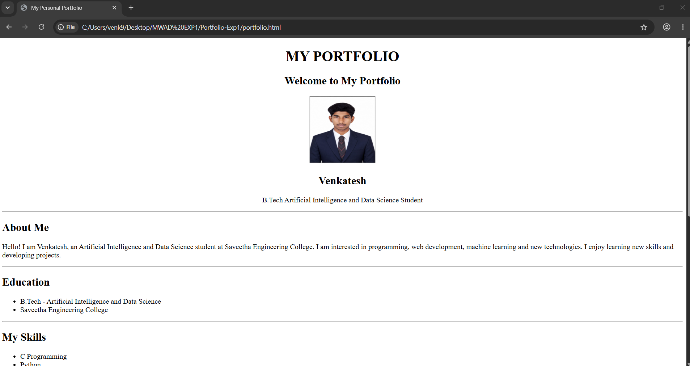

# Ex01 Portfolio
## Date: 31-10-26

## AIM
To create a Portfolio using HTML and CSS.

## ALGORITHM
### STEP 1
Create an HTML file (index.html)

### STEP 2
Create a CSS file (style.css)

### STEP 3
Include a navigation bar with links to different sections.

### STEP 4
Add structured sections for introduction, about, projects, and contact details.

### STEP 5
Define global styles for fonts, colors, and layout.

### STEP 6
Style the header, navigation bar, and sections.

### STEP 7
Use Flexbox or CSS Grid for layout design.

### STEP 8
Add hover effects and transitions for interactivity.

### STEP 9
Add Images and Media.

### STEP 10
Use optimized images for a professional look.

### STEP 11
Open the HTML file in a browser to check layout and functionality.

### STEP 12
Fix styling issues and refine content placement.

### STEP 13
Deploy the Portfolio.

### STEP 14
Upload to GitHub Pages for free hosting.

## PROGRAM
```

<!DOCTYPE html>
<html>
<head>
    <title>My Personal Portfolio</title>
</head>

<body>

    <center>
        <h1>MY PORTFOLIO</h1>

        <h2>Welcome to My Portfolio</h2>

        
             
             

        <h2>Venkatesh</h2>

        <p>
            B.Tech Artificial Intelligence and Data Science Student
        </p>
    </center>

    <hr>

    <!-- About Me -->
    <h2>About Me</h2>

    <p>
        Hello! I am Venkatesh, an Artificial Intelligence
        and Data Science student at Saveetha Engineering College.

        I am interested in programming, web development,
        machine learning and new technologies.
        I enjoy learning new skills and developing projects.
    </p>

    <hr>

    <!-- Education -->
    <h2>Education</h2>

    <ul>
        <li>B.Tech - Artificial Intelligence and Data Science</li>
        <li>Saveetha Engineering College</li>
    </ul>

    <hr>

    <!-- Skills -->
    <h2>My Skills</h2>

    <ul>
        <li>C Programming</li>
        <li>Python</li>
        <li>HTML</li>
        <li>CSS</li>
        <li>JavaScript</li>
        <li>Machine Learning</li>
    </ul>

    <hr>

    <!-- Projects -->
    <h2>My Projects</h2>

    <h3>1. Smart Agriculture Advisory System</h3>
    <p>
        A project that recommends suitable crops
        based on soil and weather conditions.
    </p>

    <h3>2. Railway Navigation System</h3>
    <p>
        A navigation system that helps passengers
        find facilities inside railway stations.
    </p>

    <h3>3. Machine Learning Projects</h3>
    <p>
        Developing machine learning models
        for prediction and classification.
    </p>

    <hr>

    <!-- Contact -->
    <h2>Contact Me</h2>

    <p>Email: venk9708@gmail.com</p>

    <p>
        GitHub:
        <a href="https://github.com/Vekuyh">
            My GitHub Profile
        </a>
    </p>

    <p>
        LinkedIn:
        <a href="https://www.linkedin.com/in/venkatesh-p-5177a3379?utm_source=share_via&utm_content=profile&utm_medium=member_android">
            My LinkedIn Profile
        </a>
    </p>

    <hr>

    <center>
        <p>© 2026 Venkatesh. All Rights Reserved.</p>
    </center>

</body>
</html>
```

## OUTPUT

## RESULT
The program for creating Portfolio using HTML and CSS is executed successfully.